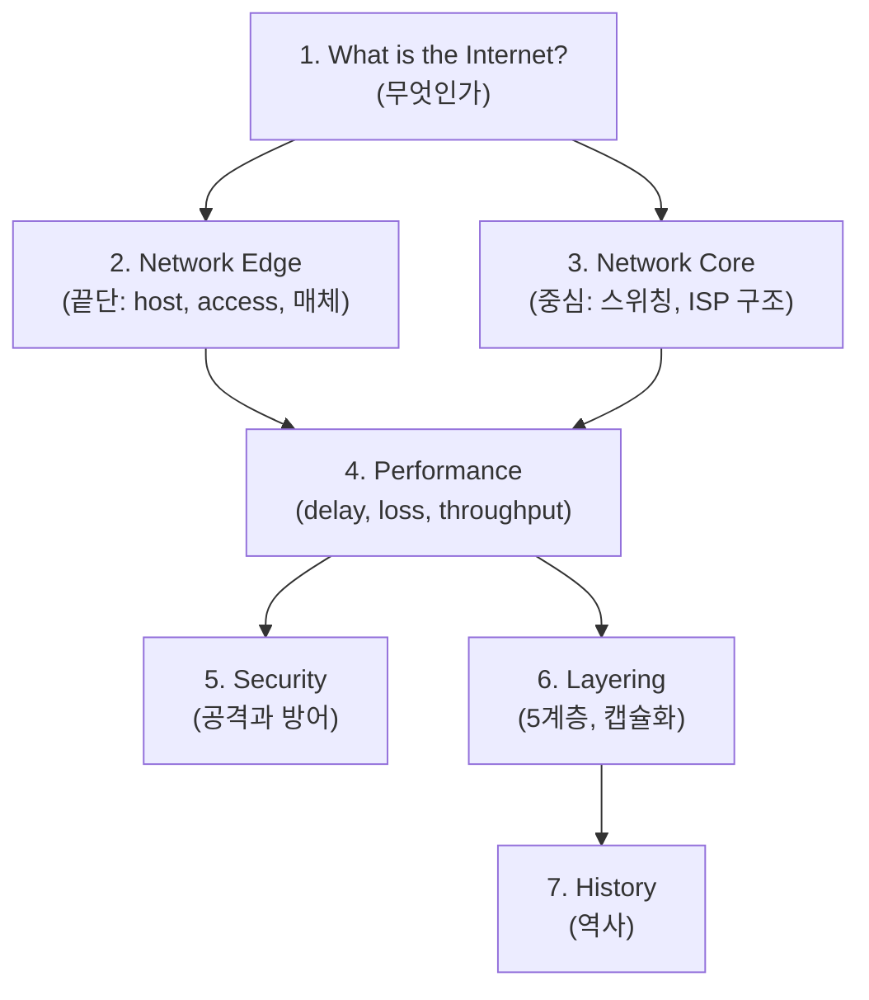
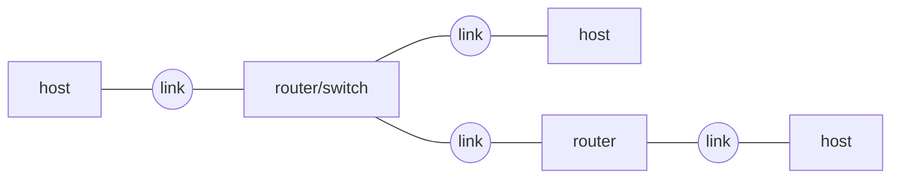
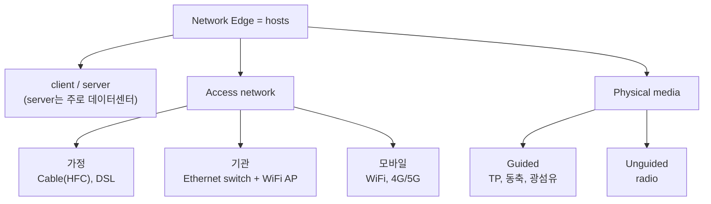
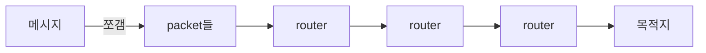
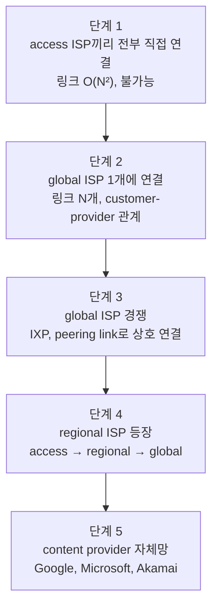
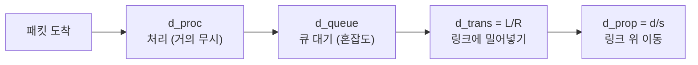
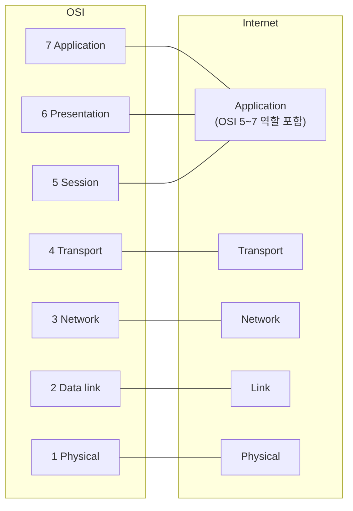
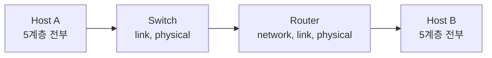
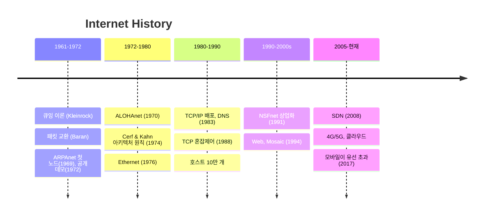
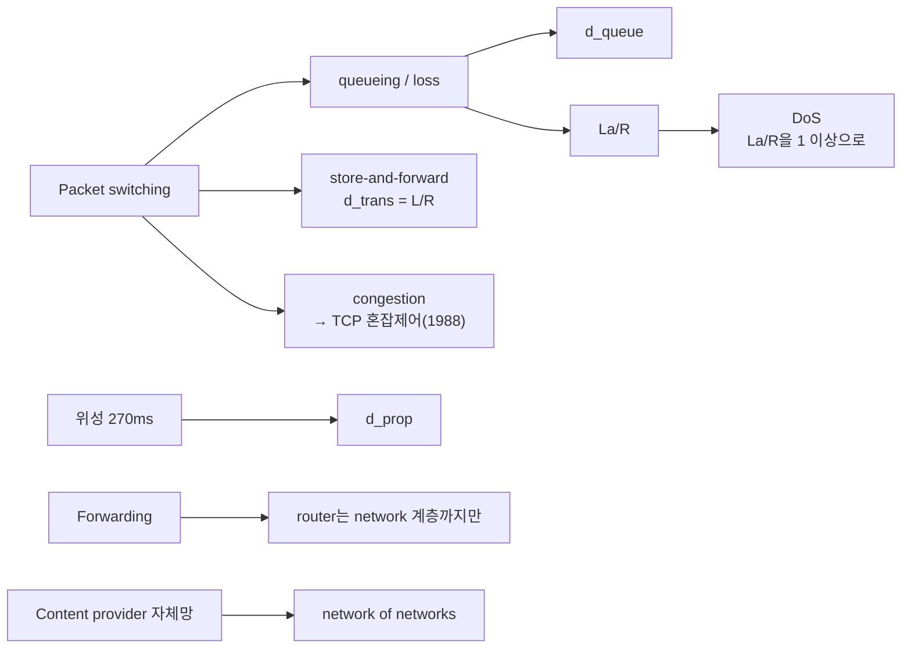

# Chapter 1 구조 정리: 인터넷 한눈에 보기

## 0. 전체 지도

챕터 1은 "인터넷이 무엇이고, 어떻게 흘러가고, 얼마나 빠르고, 어떻게 설계됐나"에 답하는 구조.



핵심 연결 고리:
- Core의 packet switching이 만드는 queueing과 loss가 4장 성능 지표로 이어짐.
- Packet switching의 congestion 문제를 풀려고 나온 게 TCP 혼잡제어(1988).
- 계층화는 위 모든 내용을 담는 설계 틀.

---

## 1. 인터넷의 두 관점

| 관점 | 질문 | 답 |
|---|---|---|
| Nuts and bolts | 뭘로 만들어졌나 | host, packet switch, link가 모인 network의 network |
| Services | 뭘 해주나 | 앱이 쓰는 infrastructure, API(hook)로 전송 서비스 제공 |



- **protocol**: 통신 규칙. 3요소는 **format**(모양), **order**(순서), **actions**(수신/송신 시 동작).
- 표준은 **IETF**가 만들고 **RFC** 문서로 관리.

---

## 2. Network Edge (끝단)



### 2-1. 가정용 access 비교

| | Cable (HFC) | DSL |
|---|---|---|
| 기반 | 케이블TV 선 (광섬유 + 동축) | 전화선 |
| 선 사용 | 이웃과 **공유** | 나만 쓰는 **전용선** |
| 다중화 | FDM (data와 TV 주파수 분리) | 주파수 분리 (data와 voice) |
| 국사 장비 | headend의 **CMTS** | central office의 **DSLAM** |
| 속도 | down 40M~1.2G / up 30~100M | down 24~52M / up 3.5~16M |
| 특징 | 비대칭, 빠르지만 공유 | 안정적, 보통 더 느림 |

### 2-2. 홈 네트워크

```
[ 공유기 한 박스 ]
  WiFi AP + router/firewall/NAT + cable/DSL modem  →  ISP
  (유선 Ethernet 최대 1Gbps)
```

### 2-3. 물리 매체

| 분류 | 매체 | 특징 |
|---|---|---|
| Guided | Twisted pair | Cat5 100M~1G, Cat6 10G |
| Guided | Coaxial | 양방향, 다중 채널 broadband (HFC) |
| Guided | Fiber optic | 빛 펄스, 10s~100s Gbps, 저에러, 노이즈에 강함 |
| Unguided | WiFi | 10~100s Mbps, 수십 m |
| Unguided | 4G/5G | 10s Mbps, ~10km |
| Unguided | Satellite | <100Mbps, 정지궤도 RTT 270ms (d_prop이 큼) |

무선 access 범위: WLAN(WiFi) 약 100ft, wide-area cellular 수십 km. Enterprise망은 Ethernet switch, WiFi AP, institutional router 조합이고, Data center망은 10s~100s Gbps 링크로 서버 수천 대를 연결.

---

## 3. Network Core (중심)

### 3-1. Packet switching



| | Forwarding | Routing |
|---|---|---|
| 범위 | local | global |
| 역할 | forwarding table 조회해 output link로 이동 | 경로 자체를 결정 (table을 만들어줌) |
| 비유 | 교차로 표지판 보기 | 출발 전 전체 경로 짜기 |

- **Store-and-forward**: 패킷 전체(L bit)가 도착해야 다음 링크로 내보냄. 한 홉 시간은 L/R (예: 10Kbit / 100Mbps = 0.1ms).
- **Queueing과 loss**: 도착률이 전송률보다 크면 큐에서 대기(queueing delay). 버퍼가 가득 차면 drop(packet loss).

### 3-2. Packet vs Circuit switching

| | Circuit | Packet |
|---|---|---|
| 자원 | end-to-end **예약**(전용) | **공유** |
| 성능 | 보장 | best-effort |
| 낭비 | 안 쓰면 idle로 낭비 | statistical multiplexing으로 효율적 |
| 분할 | FDM(주파수) / TDM(시간 슬롯) | 해당 없음 |
| 약점 | 수용 인원 적음 | congestion (delay, loss) |
| 비유 | 예약석 | 선착순 공용 좌석 |

**예제** (1Gbps 링크, 사용자 100Mbps, 활성 10%):
- Circuit: 정확히 10명만 수용.
- Packet: 35명도 가능. 10명 초과로 동시에 활성일 확률이 0.0004 미만이라서.

### 3-3. Internet structure: network of networks



최종 모양:

```
        [ Tier-1 ISP ] ═══ peering / IXP ═══ [ Tier-1 ISP ]
           ▲   ▲                               ▲
   [regional ISP]  [regional ISP]        [regional ISP]
      ▲  ▲  ▲          ▲                    ▲
   access ISP들 (가정, 기관, 모바일)
                         ┆
   [Content provider 사설망] ── tier-1 / regional을 우회해 end user에 직결
```

---

## 4. Performance: Delay, Loss, Throughput

### 4-1. 노드 지연 4요소

```
d_nodal = d_proc + d_queue + d_trans + d_prop
```



| 요소 | 결정 요인 | 줄이는 방법 |
|---|---|---|
| d_proc | 에러 체크, 경로 결정 | (보통 무시) |
| d_queue | 혼잡 정도 | traffic intensity 낮추기 |
| d_trans = L/R | 패킷 크기, 링크 속도 | R(전송률)을 올림 |
| d_prop = d/s | 거리, 매체 (s ≈ 2×10^8 m/s) | 거리를 줄임 |

카라반 비유: car = bit, caravan = packet. 톨게이트를 다 통과하는 시간이 d_trans, 도로를 달려가는 시간이 d_prop. d_prop은 패킷 크기나 링크 속도와 무관.

### 4-2. Traffic intensity = La/R

```
La/R ≈ 0  →  지연 작음
La/R → 1  →  지연 급격히 증가 (비선형)
La/R > 1  →  큐가 계속 쌓여 평균 지연 무한대
```

### 4-3. traceroute

TTL = i인 패킷을 3개씩 보냄. i번째 라우터에서 TTL이 0이 되면 그 라우터가 **ICMP** 응답을 돌려줘서 홉별 RTT를 알 수 있음. `* * *`는 응답 없음.

### 4-4. Packet loss

큐 용량이 유한하니 가득 차면 drop. 재전송은 상위 protocol에 달림 (TCP는 재전송, UDP는 안 함).

### 4-5. Throughput

- **bandwidth**는 링크의 최대 용량, **throughput**은 실제로 나오는 속도.
- **bottleneck link**: 경로에서 가장 좁은 링크.

```
단일 connection:   min(R_s, R_c)                   예: min(2M, 1M) = 1Mbps
다수 connection:   min(R_c, R_s, R / 연결 수)       backbone이 병목이 될 수도 있음
```

---

## 5. Security

인터넷은 "서로 신뢰하는 사용자"를 전제로 설계돼서 보안이 사후 대응.

| 공격 | 원리 | 대응 방어선 |
|---|---|---|
| **Packet sniffing** | broadcast media에서 promiscuous NIC로 남의 패킷까지 읽음 (Wireshark) | **confidentiality** (암호화) |
| **IP spoofing** | source 주소를 거짓으로 주입 | **authentication** (신원 증명) |
| **DoS** | botnet으로 대량 트래픽을 보내 자원 고갈 (traffic intensity > 1을 노림) | **firewall** (탐지, 대응) |
| (변조) | 전송 중 내용 변경 | **integrity check** (디지털 서명) |

나머지 방어선: **access restrictions**는 VPN 같은 접근 제한, **firewall**은 off-by-default로 허용된 것만 통과시키는 middlebox.

---

## 6. Layering & Encapsulation

### 6-1. 5계층 vs OSI 7계층



| Layer | 전달 범위 | 데이터 단위 | 프로토콜 |
|---|---|---|---|
| application | - | **message** | HTTP, SMTP, IMAP, DNS, FTP |
| transport | process ↔ process | **segment** | TCP, UDP, SCTP |
| network | host ↔ host | **datagram** | IP (+ICMP, IGMP, ARP, RARP) |
| link | 인접 노드 (1홉) | **frame** | Ethernet, 802.11, PPP |
| physical | 회선 위 bit | bit | - |

보조 프로토콜:
- **ARP**: IP주소 → MAC주소
- **RARP**: MAC주소 → IP주소
- **ICMP**: 오류/제어 메시지 (ping, traceroute)
- **IGMP**: 멀티캐스트 그룹 관리

### 6-2. Encapsulation

```
application   [        M        ]            message
transport     [ Ht |      M     ]            segment
network       [ Hn | Ht |   M   ]            datagram
link          [ Hl | Hn | Ht | M ]           frame
```

송신 측은 내려가며 헤더를 붙이고(encapsulation), 수신 측은 올라가며 벗겨냄(decapsulation).

### 6-3. 중간 장치는 필요한 계층까지만 연다



---

## 7. 역사 타임라인



Cerf & Kahn의 원칙(1974)은 오늘 인터넷 아키텍처를 정의함:
- minimalism / autonomy
- best-effort
- stateless routing
- decentralized control

---

## 8. 시험 대비 개념 연결 맵



시험 포인트:
1. message → segment → datagram → frame 순서와 각 단위의 계층
2. d_trans(L/R)와 d_prop(d/s)의 구분, delay 계산
3. circuit vs packet 수용 인원 계산 (10명 vs 35명)
4. forwarding(local)과 routing(global)의 차이
5. cable(공유)과 DSL(전용)의 차이
6. throughput = min(...) 계산
7. 공격과 방어의 짝 (sniffing/암호화, spoofing/인증, DoS/firewall)
